# Чёрный Ворон 2

**Стратегия в реальном времени для ZX Spectrum 128K, которую автор не успел закончить. Теперь её можно доделать.**

<p align="center">
  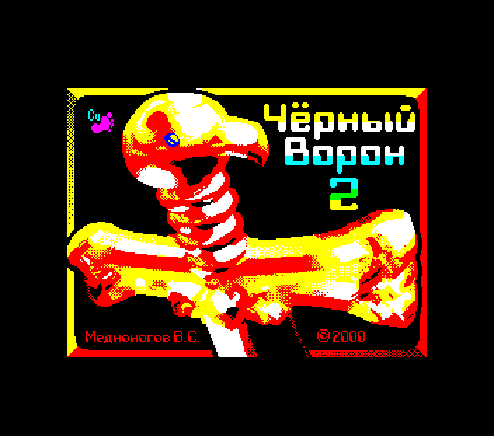
  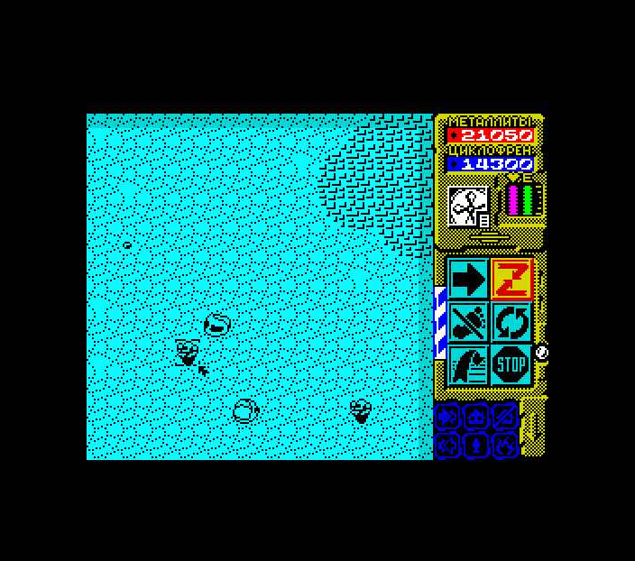
</p>

«Чёрный Ворон 2» — продолжение «Чёрного Ворона» (Copper Feet, 1997–98). Его делал Вячеслав Медноногов (1998–2000), автор
«Буратино», «НЛО» и «Чёрного Ворона». Вышли только демо-версии: последняя, **v0.04** (апрель 2000), — две отдельные
кампании за людей и за кунгов. Плюс прощальный диск с роликами, инструкцией и концовкой. На этом игра остановилась.

Здесь — исходники игры, восстановленные из авторского архива и **полностью воспроизводящие демо v0.04**. Но теперь это
не застывший снимок памяти, а живой проект:
* чистый ассемблер `sjasmplus`, который собирается одной командой в обычные диски TR-DOS;
* без защиты;
* без «снега» на Spectrum 128K;
* вся графика и тексты в PNG и обычном тексте;
* утилиты автора переписаны на Python;
* есть веб-редактор уровней.

Бери и делай новую игру.

---

## Что в итоге получилось

| | |
|---|---|
| 🎮 **Одна игра вместо двух образов.** Стартовое меню: «Люди», «Кунги», «Загрузить». Если ничего не нажимать, через 30 секунд начинается демо-бой, как задумывал автор. | 💾 **Сохранения работают.** В v0.04 они были мертвы. Теперь это 8 слотов и быстрое сохранение на диске игры, без шифрования. |
| ❄️ **Нет «снега» на Sinclair 128K/+2.** Таблица прерываний вынесена из медленной памяти — везде: в игре, роликах, инструкции и концовке. | 🔓 **Без защит.** Проверка «царапины» на диске, контрольная сумма денег, шифрование сохранений, нестандартный формат диска 5×1024 — всё убрано. |
| 📼 **Прощальный диск целиком.** Заставка, видеоролики, инструкция, гимн, обе концовки. Из меню диска можно сразу перейти в игру. | 💿 **Обычные диски TR-DOS.** Два диска по 640 КБ — для настоящего «Спектрума» — или один на 1 МБ для эмуляторов и esxDOS. |
| 🧩 **Чистые, перемещаемые исходники.** Код можно двигать: адреса символьные, это проверяет отдельный тест. Дисковый слой вынесен в отдельный модуль. | 🖌️ **Все ресурсы редактируются.** Спрайты, тайлы, кнопки, шрифт, экраны, кадры роликов — PNG в раскладке автора. Тексты инструкции и титров — UTF-8. |
| 🛠️ **Утилиты автора на Python.** Его C++-конвертеры графики и текстов (`4LAND`, `4HERO`, `4MISC`, `4BAR_BUT`, `4TV16`…) переписаны. На его же исходных картинках они дают его файлы байт в байт. | 🗺️ **Веб-редактор уровней.** Открывается в браузере и рисует настоящими тайлами игры. Одна команда собирает диск с вашим уровнем. |

## Как это выглядит

<table>
<tr>
<td align="center">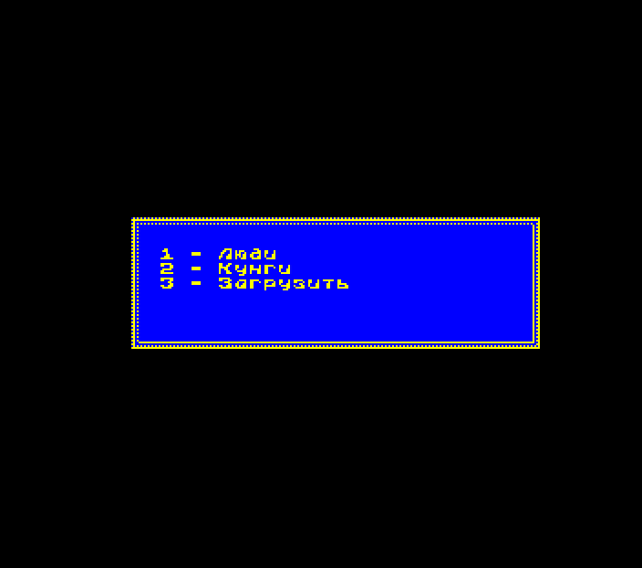<br>Стартовое меню</td>
<td align="center">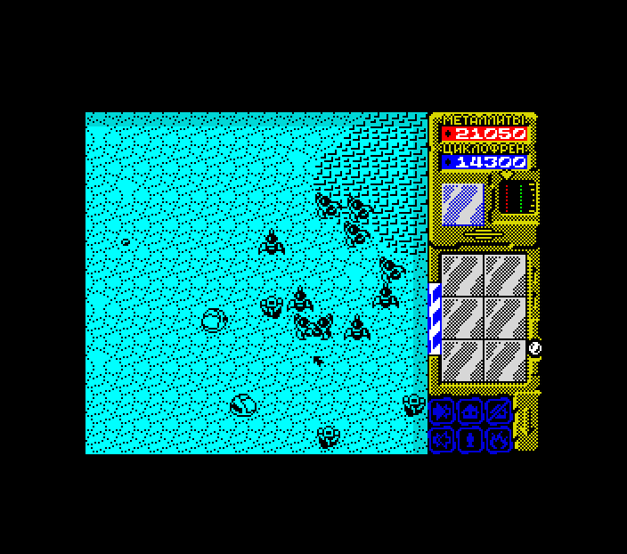<br>Демо-бой, если ничего не нажимать</td>
<td align="center">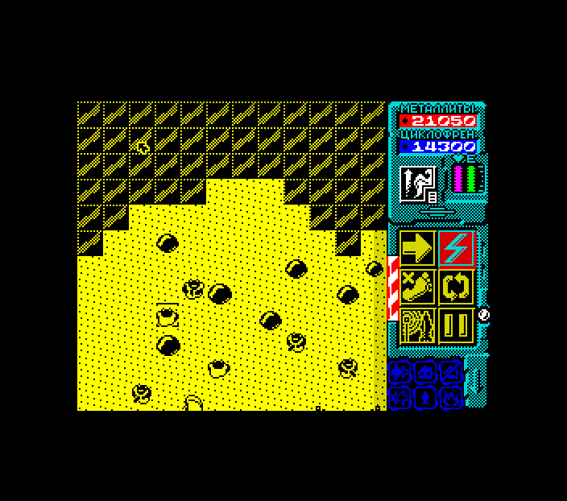<br>Кунги: туман войны</td>
</tr>
<tr>
<td align="center">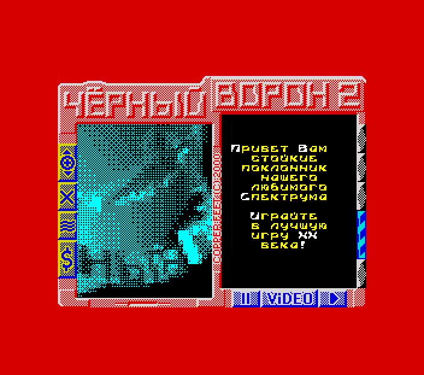<br>Ролики прощального диска…</td>
<td align="center">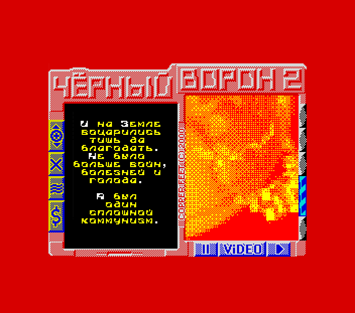<br>…их там 42…</td>
<td align="center">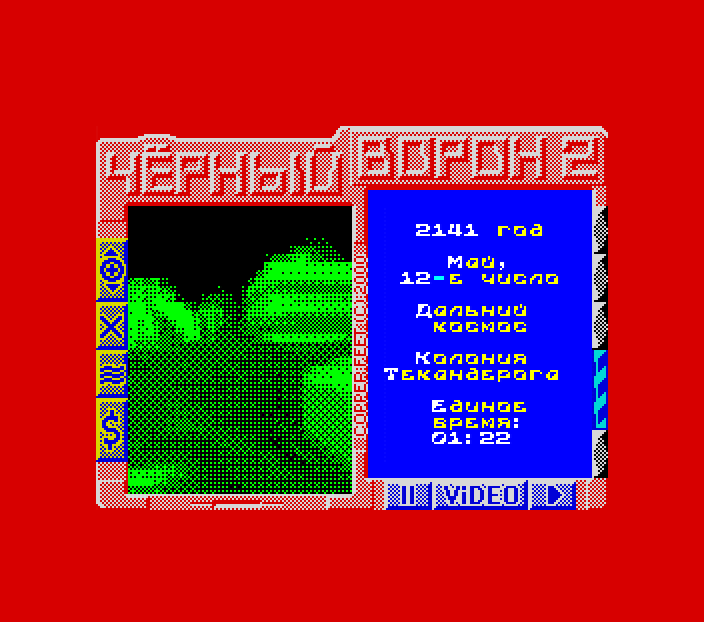<br>…с сюжетом игры</td>
</tr>
<tr>
<td align="center">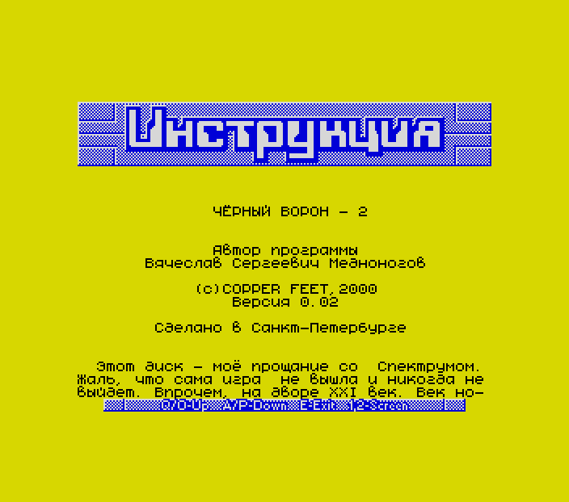<br>Инструкция</td>
<td align="center">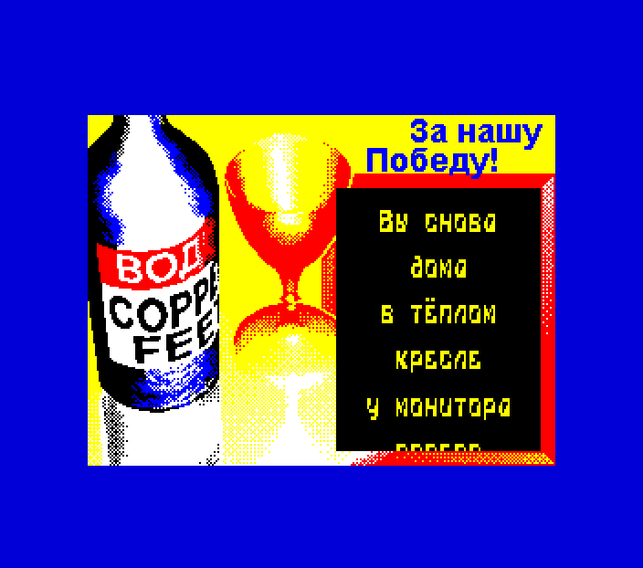<br>Концовка за людей</td>
<td align="center">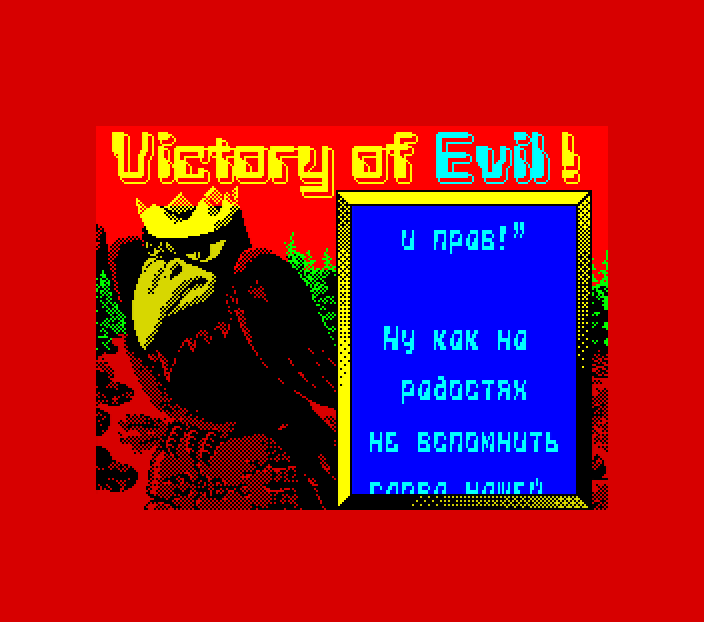<br>Концовка за кунгов</td>
</tr>
</table>

**Веб-редактор уровней:**

<p align="center">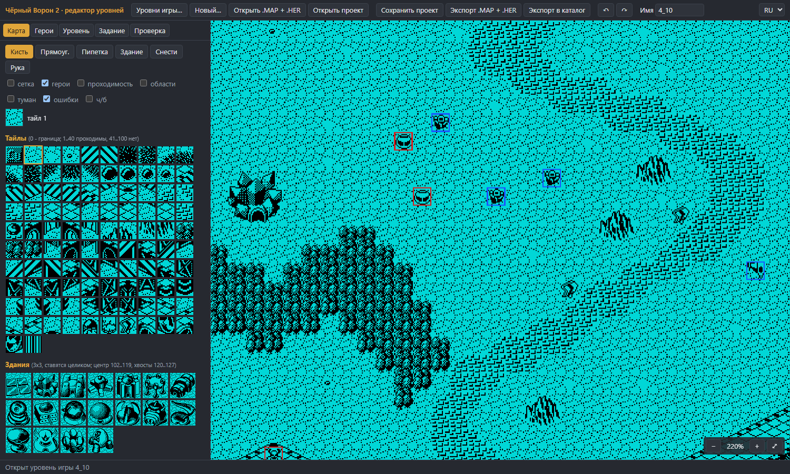</p>

## Сыграть

Скачайте готовые образы дисков в разделе **Releases** и загрузите в любой эмулятор ZX Spectrum 128K с TR-DOS (Beta Disk):

| Файл | Что это |
|---|---|
| `br2_1mb.trd` | **всё на одном диске** (1 МБ) — проще всего для эмуляторов и esxDOS. Стартует с меню прощального диска; пункт «Игра» запускает игру без смены диска |
| `br2_intro.trd` | прощальный диск (640 КБ): заставка, ролики, инструкция, концовка; пункт «Игра» попросит вставить диск игры |
| `br2_game.trd` | диск игры (640 КБ): `RUN` → меню «Люди / Кунги / Загрузить»; сохранения пишутся сюда же |

**Управление.**
* Курсор — `Q` `A` `O` `P`.
* Выделить — `CAPS SHIFT`.
* Приказ — `SPACE`.
* Щелчок по нижней панели — пауза и меню. Первый пункт меню — опции. Там, например, включается музыка AY: по умолчанию она выключена, как в оригинале.
* В меню загрузки клавиши `1`–`8` — слоты, `9` — быстрое сохранение.

**Секрет.** В инструкции на прощальном диске нажмите `1` 57 раз — концовка за людей. Нажмите `2` 54 раза — за кунгов.

## Собрать

Нужны:
* Python 3 и Pillow (ресурсы `assets_src/` — PNG);
* `sjasmplus` 1.20+ (в `PATH` или `SJASMPLUS=...`);
* `tools/bin/zx0.exe` (лежит здесь).

```
python build.py
```

В `build/` появятся три образа. Любое предупреждение ассемблера останавливает сборку.

Сборка без изменений даёт ровно те же образы, что проверялись в эмуляторе. Проверено:
* обе кампании стартуют, как в v0.04;
* демо, сохранения, ролики и обе концовки работают;
* по 15 000 кадров игры на Sinclair 128K и Pentagon без сбоев.

## Сделать своё

**Поменять графику или текст.**
1. Откройте нужный PNG в `assets_src/gfx/` или текст в `assets_src/text/` и правьте.
2. Запустите `python build.py` — правка уже в игре.

Раскладка листов — авторская: что где лежит и чего нельзя делать с каждым видом ресурсов, расписано в [docs/TOOLS.md](docs/TOOLS.md).

**Нарисовать уровень.**
1. Откройте [editor/index.html](editor/index.html) двойным щелчком.
2. Рисуйте карту 64×64 тайлами игры, ставьте здания целиком, расставляйте героев, смотрите миникарту — как в режиме «карта» в игре.
3. Сохраните `.MAP` и `.HER` и соберите диск со своим уровнем:

```
python -I tools/put_level.py --side hum --map мой.MAP --her мой.HER
```

Подробно — в [editor/README.md](editor/README.md).

**Переделать игру.** Код лежит в `src/` и разбит по модулям, как у автора. Карта памяти, диски, что и почему менялось — в
[docs/NOTES.md](docs/NOTES.md).

## Чего пока нет (честно)

Это демо, и многое в нём автор не успел:
* **Два уровня.** По одному на сторону, как в v0.04. Остальные карты в архиве автора — пробные или в старом формате.
* **Нет заданий и брифинга.** Уровень играется до победы или поражения; механизма заданий в v0.04 нет.
* **Ландшафты 42SPR и 43SPR** нарисованы, но законченных карт на них у автора нет.
* **Деньги кунгов на старте — 21050, как у людей.** В образе кунгов v0.04 было 21150, но этот образ снят уже во время игры. Что 21150 не стартовое значение, доказано только косвенно.
* **Следы реконструкции.** Часть кода восстановлена из образа v0.04, а не из исходников:
  * 135 таких кусков пока называются `v4_…`;
  * 44 места помечены «probably» — назначение угадано, а не доказано.
* **Не редактируются:** три страницы интро (`LP2`–`LP4`). Упаковщика LPZ автора нет: изменённый ролик пережимается нашим упаковщиком и может не влезть на прежнее место на диске.

## Устройство

```
build.py              сборка всего: игра -> файлы диска -> три образа
src/game/             игра (страницы 128K): game.asm - корень, main.asm - порядок модулей, disk.asm - дисковый слой,
                      io.asm - ресурсы, уровни, сохранение; startm.asm - запуск; demo*.asm - демо; menu.asm - меню
src/start1/           загрузчик, интро, инструкция, ролики (tv16.asm); flicks.txt - список роликов диска 1
src/final/            концовка
src/lib/dzx0.asm      распаковщик ZX0
assets_src/           РЕДАКТИРУЕМЫЕ ресурсы: PNG, UTF-8, CSV; build.py делает из них двоичные
assets/               двоичные ресурсы (эталон для проверки; python build.py --bin-assets собирает из них)
tools/                assets.py, check_assets.py, gfx/, txt/ (утилиты автора на Python), trd.py, zx0.py, lpz.py,
                      put_level.py (уровень из редактора -> диск), check_reloc.py, check_loader.py, emu/ (стенд эмулятора)
editor/               веб-редактор уровней
docs/                 NOTES.md - устройство; TOOLS.md - утилиты и ресурсы; ANALYSIS.md, V04.md, V04_RECON.md - разбор архива и v0.04
```

**Проверки:**

```
python -I tools/check_assets.py   # ресурсы: круг assets <-> assets_src байт в байт; утилиты против архива автора
python -I tools/check_reloc.py    # код перемещаем: сдвиг страниц 0 и 5 не ломает адреса
python tools/check_loader.py      # загрузчик ни с чем не пересекается
python -I editor/test/run_tests.py
```

В репозитории нет `build/`, `work/`, `archive/` и `reference/`. Первые две создаются при работе. Авторский архив и чужие
образы дисков здесь не распространяются. Для сборки игры они не нужны. Нужны только для сверок с оригиналом — `check_assets.py` и
тестов редактора: положите архив автора в `archive/unz/BR2_DEMO`.

## Спасибо

* **Вячеславу Медноногову aka Copper Feet** — за игру. Все права на игру, её графику, музыку и тексты принадлежат автору. Этот репозиторий — восстановление и
  сохранение его работы.
* **Эйнару Саукасу** — за упаковщик [ZX0](https://github.com/einar-saukas/ZX0).
* Авторам [sjasmplus](https://github.com/z00m128/sjasmplus).
