# Чёрный Ворон 2 · редактор уровней

**Рисуйте свои уровни для «Чёрного Ворона 2» прямо в браузере.** «Чёрный Ворон 2» (демо v0.04, Copper Feet, 1998–2000) — стратегия в реальном времени
для ZX Spectrum 128K. Редактор показывает карту, здания и героев той же графикой, что и игра, в цветах уровня. Файлы `.MAP` и `.HER` он пишет так же,
как авторский редактор карт MAPPER: байт в байт. Готовый уровень можно одной командой собрать в образ диска (`tools/put_level.py`) и запустить в эмуляторе.

Ничего не нужно ставить: это одна страница HTML. Откройте `index.html` — и можно рисовать. Все 12 карт автора из архива демо встроены в редактор
(кнопка «Уровни игры…»). Интерфейс — на русском и английском (переключатель RU / EN вверху справа). Редактор сделан на основе редактора уровней «Чёрного Ворона» 1.

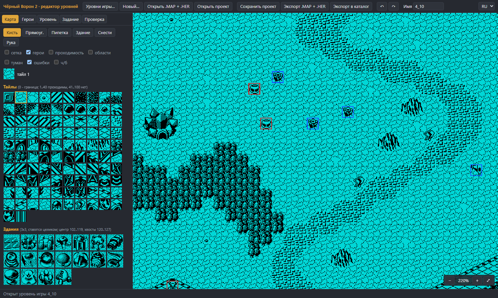

## Что можно делать

| | |
|---|---|
| 🗺️ **Рисовать карту 64×64** тайлами любого из пяти ландшафтов (41SPR–45SPR). Есть кисть, прямоугольник, пипетка, масштаб колесом, сдвиг вида мышью и отмена. | 🏰 **Ставить здания целиком.** Здание 3×3: центр 102–119 и восемь «хвостов» 120–127 редактор расставляет сам и не даёт поставить два здания вплотную, как MAPPER. |
| ⚔️ **Расставлять героев** — 24 вида и 7 предметов (металлит, циклофрен, телепорт, выключатель, заборы, мина). Сторона: люди, кунги, пленники; рамка показывает сторону. Патруль — по полям x, y. | 🌫️ **Видеть игру такой, какая она будет**: цвет поля людей (#28) и кунгов (#30), туман кунгов (тайл 411; вокруг своих героев открыто 5×5, как в игре), проходимость, области. |
| ✅ **Проверять уровень на ходу** по правилам MAPPER (ERR1–ERR7) и дополнительным: границу, здания, число героев, герои на непроходимых клетках, патруль. Щелчок по строке показывает место. | 📜 **Править задание** (`.TSK`, `.TS2`) шрифтом игры. Честно: в v0.04 игра задание уровня не показывает — см. «Ограничения». |

<table>
<tr><td>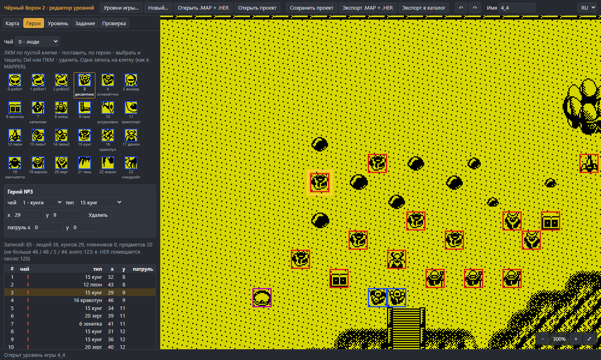</td><td>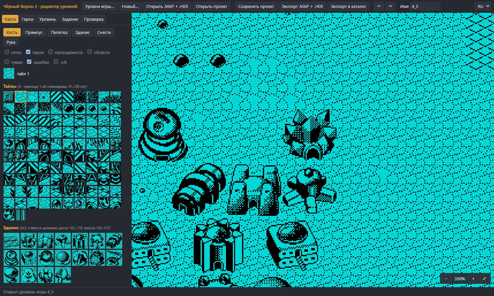</td></tr>
<tr><td align="center">Герои (уровень кунгов 4_4)</td><td align="center">Здания (4_5)</td></tr>
<tr><td>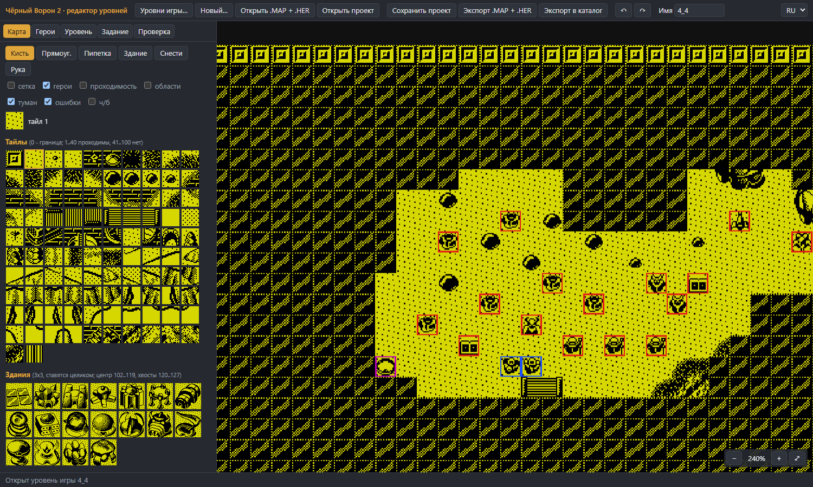</td><td>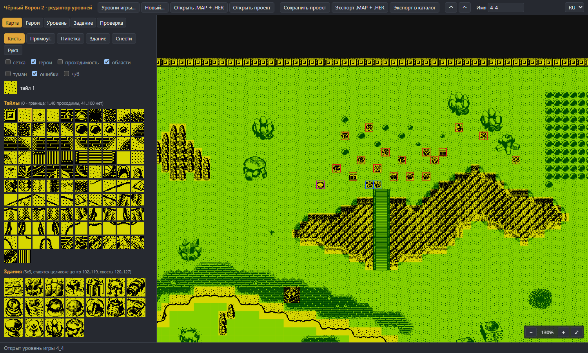</td></tr>
<tr><td align="center">Туман кунгов в начале игры</td><td align="center">Области связности (слой «области»)</td></tr>
<tr><td>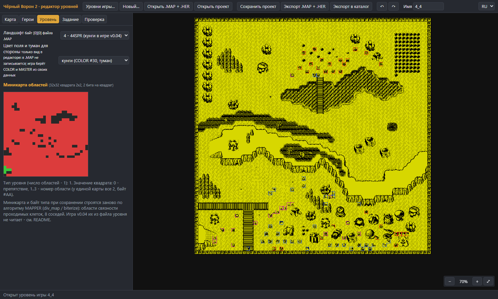</td><td>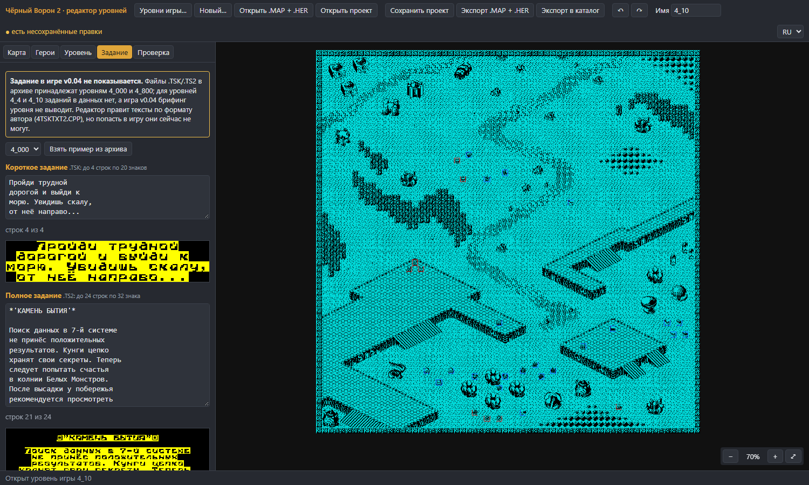</td></tr>
<tr><td align="center">Вкладка «Уровень»: ландшафт, миникарта как в игре и миникарта областей</td><td align="center">Задание шрифтом игры (пример из архива)</td></tr>
<tr><td>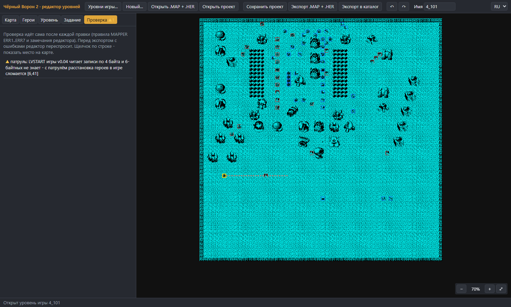</td><td>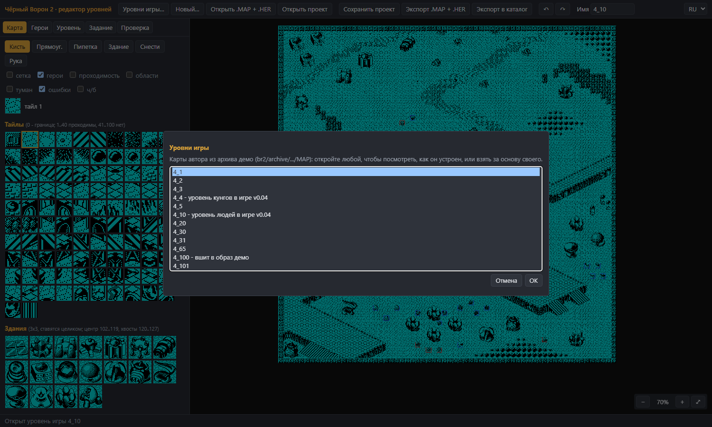</td></tr>
<tr><td align="center">Проверка</td><td align="center">Встроенные уровни игры</td></tr>
<tr><td colspan="2">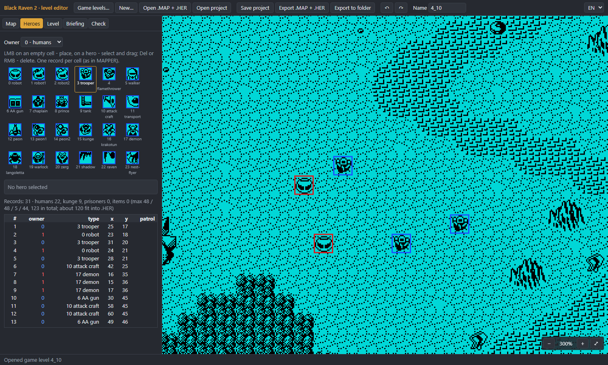</td></tr>
<tr><td colspan="2" align="center">English interface</td></tr>
</table>

**Форматы.** Редактор открывает и сохраняет пару `.MAP` (4353 байта) + `.HER` (496 байт), задания `.TSK` (84 байта) и `.TS2` (792 байта) и собственный проект `.json`.
Все 12 пар `.MAP/.HER` из архива автора проходят круг «открыть → сохранить» с побайтным совпадением, в том числе миникарта и тип уровня, которые редактор строит сам.

---

## Запуск

Открыть `editor/index.html` в Chrome, Edge или другом браузере на Chromium (двойной щелчок, `file://`). Если браузер не пускает `file://`:

```
python -I -m http.server 8000 --directory editor
```

и открыть `http://localhost:8000/`. «Экспорт в каталог» пишет файлы прямо в выбранный каталог (Chrome, Edge); в остальных браузерах сохраняется `.zip`.

В адресе можно указать `?lang=en`, `?open=4_4` (какой встроенный уровень открыть), `?tab=heroes`, `?opts=fog,parts` (слои), `?at=32,8&zoom=3` (куда смотреть) — так сделаны снимки в `img/`.

## Форматы (по MAPPER и коду игры)

Источник — авторский редактор карт `archive/unz/BR2_DEMO/MAPPER/GAMELOOP.CPP` (функции `load_map`, `load_hero`, `save_map`, `save_hero`, `div_map`, `biterize`, `draw_qu`,
`action`, `Game_Help`, комментарий с таблицей тайлов в конце файла) и код игры `src/game`.

**`.MAP`, 4353 байта** (`save_map`, `load_map`):

| смещение | что |
|---|---|
| 0–4095 | карта `map[y][x]`, 64×64, по строкам. **Байт `[0][0]` — номер ландшафта 0..4** (файл `41SPR.DAT`…`45SPR.DAT`: `NL=map[0][0]; map[0][0]=0`). Остальные три угла и рамка — тайл 0 |
| 4096–4351 | миникарта областей: 32 строки × 8 байт; байт = 4 квадрата 2×2, по 2 бита (0 — препятствие, 1..3 — номер области). У единой карты — `#AA` везде |
| 4352 | тип уровня `isDIV` = число областей − 1 (у 4_4 — 1, у 4_30 — 4) |

Миникарту и тип редактор строит **алгоритмом MAPPER** (`div_map` + `biterize`): клетка открыта, если её тайл 1..40 (меньше `MAY_MOVE=41`; `забор А` (предмет 204) закрывает клетку, `забор Б`
(205) закрывает и клетку над собой), здания (тайл > 100) тоже считаются открытыми; области — связные куски по 8 соседям; область номер > 3 записывается как 0. На всех 12 картах архива результат
совпадает с байтами автора. Старые файлы из `MAP/4_MAP.ZIP` (4096 байт, без миникарты) см. «Ограничения».

**Тайлы** (`draw_qu`, таблица в конце `GAMELOOP.CPP`): 0 пусто/граница; 1–3 трава; 4–5 проходы; 6–14 пожарище; 15–18 мазут; 19–27 тропы; 28–31 углы берега; 32–37 мосты; 38–40
оформление — всё это проходимо (`<41`, то же и в игре: `go_Max EQU 41`, `setMAP` в `src/game/lib1a.asm`); 41–100 непроходимо (лес 49–51, берег 52–55, горы 56–93, вода 94–100 — анимированная в MAPPER, в
редакторе показан первый кадр). Строить можно на тайлах 1..14 (на ландшафтах 3 и 4 — 1..5, `MAY_BLD`). Файл ландшафта — 13184 байта = 412 спрайтов 16×16 (по 32 байта: два столбца по 16 строк, бит 1 — чернила);
в таблице 120–263 лежат спрайты частей зданий, 390–410 анимация, **411 — туман**.

**Здания** (`action`, `draw_qu`): 3×3 клетки. Центр 102..119 (102 стройка, 103 штольня/шахта, 104–111 здания людей, 112–119 здания кунгов), вокруг него в клетках лежат «хвосты» 120..127; хвост `120+d`
стоит в клетке центр+`DXY[d]` (`d`: 0 слева, 1 сверху-слева, 2 сверху, 3 сверху-справа, 4 справа, 5 снизу-справа, 6 снизу, 7 снизу-слева), а при рисовании его спрайт — `(центр−102)·8+120+d`.
Здание ставится, если центр в клетках 2..61 и в восьми соседних клетках нет значений ≥102. Лимиты `Game_Help`: зданий на сторону ≤32, шахт (103) ≤8.

**`.HER`, 496 байт** (`load_hero`, `save_hero`): записи по 4 байта `{чей, тип, X, Y}` или по 6 байт `{чей+#80, тип, X, Y, X патруля, Y патруля}`, конец — `#FF` (остаток файла `#FF`). `чей`: **0 люди, 1 кунги, 2 пленники, 4 предмет**.
Тип: героя 0..23 (в MAPPER одинаковый список для всех трёх сторон: `робот, робот1, робот2, десантник, огнемётчик, волкер, зенитка, капеллан, князь, танк, штурмовик, транспорт, пеон, пеон1, пеон2, кунг, кракотун,
демон, ланголетта, варлок, зерг, тень, ворон, гнездолёт`), предмета 0..6 (`металлит-концентрат, циклофрен-концентрат, телепорт, выключатель, забор А, забор Б, мина`). Одна запись на клетку (`map2[y][x]`);
записываются по клеткам сверху вниз, слева направо; запись останавливается, как только счётчик байт превысит 490. Лимиты: людей и кунгов ≤48, пленников ≤5 (`ERR1`: условие `ssave>5`; в закомментированном тексте старой версии было 6), всех вместе ≤123, предметов ≤44.
Герой ставится только на проходимую клетку; `ERR2` MAPPER срабатывает на тайл 0 и ≥40.

В игре (`LVSTART`, `src/game/map.asm`) `чей` <2 сравнивается с `MASTER` (кто играет), у «своих» открывается туман; ≥4 — предметы. **Записи по 6 байт (патруль) LVSTART v0.04 не понимает** (шаг всегда 4 байта):
в игре v0.04 карта с патрулём расставит героев неправильно. В архиве патруль есть только в одной записи (4_101). Редактор патруль умеет и предупреждает об этом.

**`.TSK`** — 4 строки × (20 знаков шрифта + `#7F`) = 84 байта; **`.TS2`** — 24 строки × (32 знака + `#7F`) = 792 байта, строки лежат вперемежку (0, 23, 1, 22, …). Знаки — по таблице `code[]` из `4TSKTXT2.CPP`
(шрифт `DATA/4FONT.FNT`, 114 знаков 8×8). Текст центрируется по строке и по вертикали (`conv_one_task`). Круг «расшифровать → собрать» проверен на `4_000` и `4_800`.

## Как уровень попадает в игру: `tools/put_level.py`

```
python -I tools/put_level.py --side hum --map мой.MAP --her мой.HER     # вместо уровня людей
python -I tools/put_level.py --side kun --map мой.MAP --her мой.HER     # вместо уровня кунгов
```

Результат — `build/put/<сторона>_<имя>/br2_1mb.trd` (и `br2_game.trd`, `br2_intro.trd`). Скрипт **не правит `build.py`** и не трогает `assets/` и `build/` (кроме `build/put/`): он копирует
во временный каталог `build.py`, `src/`, `assets/`, `tools/*.py`, `tools/bin`, `work/src_v04/start1`, `archive/.../TV16`, подменяет там файлы уровня и запускает в копии `python build.py` (около минуты;
нужен `sjasmplus`, как для обычной сборки). Что подменяется (по `build.py` и `src/game/level.asm`, `io.asm`):

* люди: `assets/hum/M_r6161_8000.bin` (карта, 4096 байт, `INCBIN` в `level.asm`) и `assets/hum/datMIN.bin` (16 байт параметров шахт остаются, дальше — 496 байт `.HER`);
* кунги: `assets/map/4_4.map` (берутся первые 4096 байт) и `assets/map/4_4.her`.

Миникарта и тип уровня в файл уровня игры не попадают: `LODlev` распаковывает MAP (4096) и BUF512 (16 + 496). Ландшафт игры задаёт не карта, а переменная `fsLAND` (люди 5 → 45SPR, кунги 4 → 44SPR);
у людей `[0][0]` должен быть 4, у кунгов 3 — тогда редактор показывает ровно то, что нарисует игра. В диск с игрой входят только ландшафты 44SPR и 45SPR.

Запуск в эмуляторе (порт `EMU_PORT=8861`): `python -I tools/emu/run_emu.py play name=t trd=put/hum_мой/br2_1mb.trd machine=128k beta=1 snow=1 "steps=boot,w500,K2,w300,d1,w3,u1,w200,d1,w3,u1,w900,s:a"`
(после логотипа идёт демо; первое нажатие `1` выходит из него в меню, второе — «Люди»; для кунгов `2`).

### Проверка в игре

На карту уровня людей 4_10 редактором (`core.js`) нанесено: ряд горного тайла 70 в клетках (19..24, 11), столбец тайла 58 в (19, 12..14) и здание 105 с центром в (22, 14) — левый верхний угол стартового вида игры.
Стартовый вид людей — 12×12 клеток с левым верхним углом (19, 11) (найдено сопоставлением снимка игры с рендером карты, расхождение только в клетках с героями). Затем `put_level.py`, эмулятор, снимок:

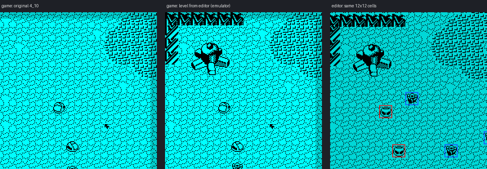

Слева оригинальная игра, в середине игра с уровнем из редактора, справа тот же участок в редакторе: горы и здание совпадают; все тайлы вида, кроме клеток с героями, совпадают с рендером редактора. Уровень кунгов 4_4 проверен так же
(ряд и столбец тайла 58 у стартовых героев кунгов в клетках (30..34, 6) и (30, 7..10) видны в игре; туман кунгов в игре — тот же косой тайл 411, что в слое «туман»). Снимки сохранены в `build/put/`.

## Что перенесено из редактора BR1, что переписано, что ново

Оценка по числу непустых строк (идентичные строки против BR1; «переписано» — та же структура с другим содержимым): как есть ~40 %, переписано на основе BR1 ~25 %, новое ~35 %.

* **как есть**: оболочка страницы и стили, вид (масштаб колесом, сдвиг, «вся карта»), отмена и возврат (снимки уровня), кисть и прямоугольник, перетаскивание героев, диалоги, язык RU/EN (`i18n.js`), PNG и ZIP-запись, проверка перевода;
* **переписано**: модель уровня и форматы (вместо блока 12608 байт — `.MAP`/`.HER`), здания (3×3 из MAPPER вместо 3×3/2×2 BR1), справочники героев и тайлов, вкладки, проверка уровня, тесты, `make_data.py`;
* **новое**: миникарта как режим «карта» в игре (значки 3×3 по таблице ландшафта MPsign, щелчок — переход к месту), миникарта и тип уровня по алгоритму MAPPER, слои «области» и «туман», пипетка, патруль, предметы, задание `.TSK`/`.TS2`, `tools/put_level.py`.
* **убрано** (в BR2 такого нет): сценарий Z80 и библиотека сценариев, параметры (деньги, лес, вооружение, ИИ) из блока уровня BR1, заставка-экран. Параметры уровня BR2 лежат в коде игры (`LEVVARS`), а не в файле уровня.

## Проверка

```
python -I editor/test/run_tests.py
```

(нужны Python 3 и node 18+). Что проверяется:

1. все 12 пар `.MAP/.HER` архива: открыть → сохранить — побайтно (4353 + 496 байт); встроенные в `data/br2data.js` данные равны файлам архива;
2. миникарта и тип, построенные по алгоритму MAPPER, равны записанным автором (12 из 12); проект `.json` туда и обратно;
3. задания `.TSK`/`.TS2`: расшифровать → собрать — те же байты (`4_000`, `4_800`);
4. правки: здание (центр, хвосты, запреты), кисть по хвосту сносит здание, патруль пишется 6 байтами, туман 5×5; на всех картах автора проверка не находит ошибок;
5. `data/br2data.js` воспроизводится `tools/make_data.py` без изменений; у каждой русской строки интерфейса есть английская (`test/i18n_check.py`); синтаксис JS.

Снимки в `img/` делает `python -I editor/tools/shot.py "open=4_4&tab=heroes" img/x.png` (headless Chrome или Edge, свой временный `http.server`).

## Устройство

```
editor/index.html, css/, js/app.js   интерфейс
editor/js/core.js                    модель уровня и форматы (без DOM; тот же код проверяется в node)
editor/js/i18n.js                    язык интерфейса: английский перевод (ключ - русский текст)
editor/data/br2data.js               12 карт автора, ландшафты 41..45SPR, спрайты героев и предметов, шрифт, задания (создаётся make_data.py, не править)
editor/tools/make_data.py            пересоздать br2data.js (Python, запуск с -I)
editor/tools/shot.py                 снимок страницы в headless-браузере
editor/test/                         run_tests.py, roundtrip.js, i18n_check.py
tools/put_level.py                   уровень из редактора -> диск TR-DOS (без правки build.py)
```

Спрайты героев и предметов `make_data.py` берёт так же, как MAPPER (`load_img`, `conv`): для типа — лист `DATA/HERO/*.dat` и правило выбора (`2`, `3`, `4`, `x`, `z`), 2 столбца по 16 строк пар байт (маска, маска xor рисунок). У крупных
спрайтов (танк, штурмовик, транспорт, тень, ворон, гнездолёт) MAPPER берёт только часть 16×16 — так и здесь.

## Ограничения и неизвестное

* **Задание в v0.04 не показывается** (`docs/NOTES.md`, п. 1.3): у уровней 4_4 и 4_10 в данных нет ни `.TSK`, ни `.TS2` (в архиве только 4_000 и 4_800), а игра v0.04 брифинг не выводит. Редактор правит и сохраняет задания,
  но в игру они сейчас попасть не могут. Назначение знака `*` («переключает на яркий») известно только из комментария `4TSKTXT2.CPP`.
* **Миникарта и тип** игрой v0.04 из файла уровня не читаются (`LODlev` грузит MAP + BUF512); код, который их использовал (`LOADMM`, `isDIVMAP`), в v0.04 недостижим (`docs/NOTES.md`). Для будущих версий они пишутся как у автора.
* **Архив содержит 12 пар** `.MAP/.HER` в `MAP/`, а не 26 (26 — число файлов `4_*` вместе с `4_MAP.ZIP`, `MAPZIP.BAT` и др.). В `4_MAP.ZIP` лежат ещё `4_0`, `40_S1`, `4301_S1` и старые версии прочих уровней
  в более раннем формате: `.MAP` 4096 байт, а `.HER` с типами до 124 (первый байт записи там читается иначе). Редактор открывает такой `.MAP` (миникарту строит при сохранении), но этот старый `.HER` не разбирает — формат неизвестен, в редактор эти уровни не встроены.
* **Патруль**: формат записи ясен (MAPPER), но игра v0.04 его не читает (см. выше). Как в игре ведёт себя «патрулирующий» герой, по MAPPER и коду v0.04 установить нельзя.
* **Типы героев**: названия — из таблицы `styp` MAPPER. Как игра трактует один и тот же тип у людей, кунгов и пленников (например, «кунг» у стороны «люди»), в MAPPER не определено; 4_10 содержит и тип 12 (пеон), и 17 (демон) у кунгов, 0 (робот) и 3 (десантник) у людей.
* **Цвета**: поле — по `COLOR` игры (люди #28, кунги #30; `build.py`, `docs/NOTES.md`), чёрные чернила. Цвета рамок сторон (синий, красный, зелёный, пурпурный) — выбор редактора; игра рисует героев в цветах поля. В MAPPER цвет стороны (палитра DirectDraw) в
  файлах не определён.
* **Не перенесено из MAPPER**: копирование и вставка куска карты (`V`), заливка (`*`), сохранение карты в BMP (`G`), анимация воды, режимы экрана. Проходимость и области показываются слоями (в MAPPER клавиша `D`).
* `put_level.py` копирует `src/` и `assets/` как они лежат в момент запуска: если их правят параллельно, в сборку попадёт промежуточное состояние. Сборка с нуля занимает около минуты.
